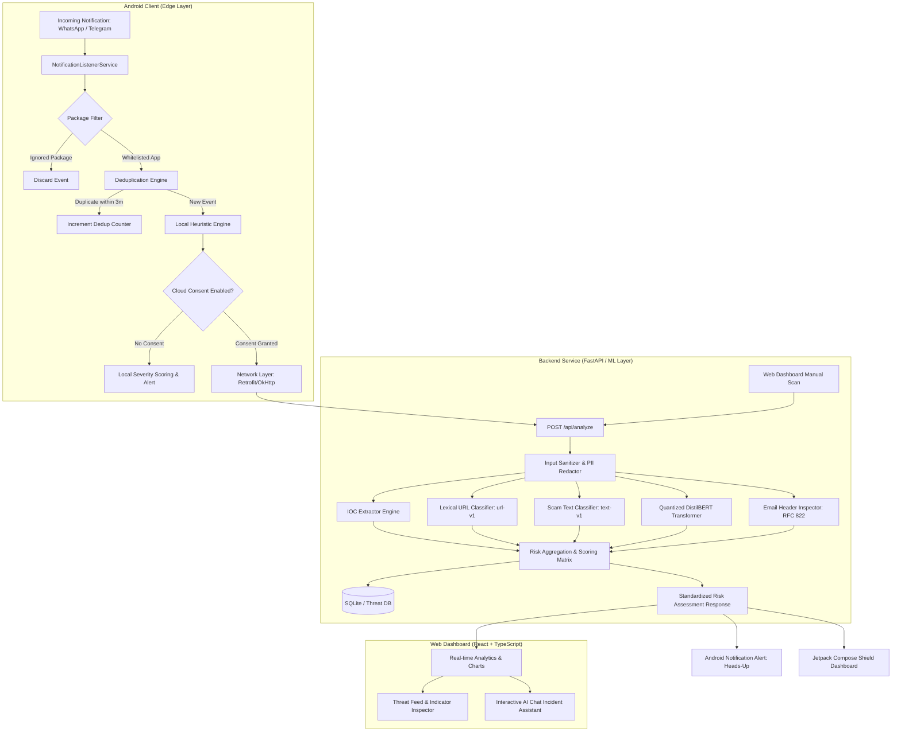

# THREATFORGE: Comprehensive System Architecture & Engineering Documentation

**AI-Powered Cyber Threat Intelligence, Mobile Phishing Defense & Fraud Risk Engine**  
*Hackathon / Production Prototype Technical Specification*

---

## 1. Executive Summary

**ThreatForge** is a multi-tier, privacy-first cybersecurity platform engineered to detect, classify, and neutralize cyber threats across mobile communication apps (WhatsApp, Telegram, SMS), emails, and web links in real time. 

Modern cyber threats increasingly rely on social engineering, credential phishing, brand spoofing, and urgency coercion across messaging applications. ThreatForge bridges the gap between client-side mobile protection and enterprise-grade threat intelligence through a three-layer architecture:
1. **Edge Client (Android)**: Native Android service utilizing `NotificationListenerService` with on-device heuristics, SHA-256 deduplication, and package whitelisting to inspect notifications with zero battery drain and complete user privacy.
2. **Inference & Intelligence Backend (FastAPI)**: A high-performance Python backend combining INT8-quantized DistilBERT Transformer models, Lexical URL feature extraction, RFC 822 email header verification, and automated honeypot counter-engagement agents.
3. **SOC & Analytics Web Dashboard (React + TypeScript)**: A modern operations console providing live telemetry, indicator extraction, severity breakdown, and AI-assisted incident response.

---

## 2. End-to-End System Architecture



---

## 3. Machine Learning & Detection Engines

### 3.1. Deep Transformer Phishing Detector (`DistilBERT`)
- **Model**: `cybersectony/phishing-email-detection-distilbert_v2.4.1`
- **Optimization**: Dynamic **INT8 Quantization** applied to linear layers (`torch.quantization.quantize_dynamic`).
- **Performance**:
  - Memory Footprint: Reduced from ~260MB to ~130MB.
  - Inference Latency: **20ms – 50ms** on CPU.
- **Explainability**: Outputs class index distribution, candidate label mapping (`legitimate_email` vs. `phishing_url`), model confidence (up to 99.99%), and uncertainty intervals.

### 3.2. Lexical URL Threat Classifier (`url-v1`)
- **Architecture**: `StandardScaler` + `LogisticRegression` trained on 60,000 URLs.
- **Dataset**: `backend/data/urls_normalized.csv` (48,000 train / 12,000 test split).
- **Evaluation Metrics**:
  - **Accuracy**: 75.08%
  - **Precision**: 79.82%
  - **Recall**: 67.12%
  - **F1-Score**: 0.7292
- **Zero-Network Lexical Feature Extraction (23 Features)**:
  1. Total URL length & hostname length
  2. Subdomain count & depth
  3. Delimiter frequencies (dots, hyphens, slashes, underscores, `@`, `?`, `=` percent signs)
  4. Digit-to-character ratio & special character ratio
  5. Shannon Entropy of entire URL and hostname (detects DGA / randomized domains)
  6. Direct IP address host detection (e.g. `http://192.168.1.1/login`)
  7. Internationalized Domain Name (IDN) Punycode detection (`xn--` spoofing)
  8. Sensitive keyword matching (`login`, `verify`, `secure`, `account`, `banking`, `kyc`, `wallet`)
  9. High-risk TLD checks (`.xyz`, `.top`, `.tk`, `.ml`, `.ga`, `.cf`, `.gq`, `.buzz`)

### 3.3. Message Text Classifier (`text-v1`)
- **Architecture**: `TfidfVectorizer` + `LogisticRegression` calibrated on real SMS/messaging scam datasets.
- **Safety Fallback**: If models are absent or CPU execution is constrained, the engine automatically falls back to deterministic heuristic regex rules without service disruption.

### 3.4. Email Header Security Analyzer (RFC 822)
- Inspects email routing hops and security authentication:
  - **SPF (Sender Policy Framework)**: PASS, FAIL, SOFTFAIL, NEUTRAL.
  - **DKIM (DomainKeys Identified Mail)**: PASS / FAIL verification.
  - **DMARC (Domain-based Message Authentication, Reporting & Conformance)**: Enforcement validation.
  - **Display Name Spoofing**: Detects when sender display name matches known brands while `From:` address points to untrusted external domains.

### 3.5. Threat IOC Extractor & Privacy Sanitizer
- Extracts deduplicated Indicators of Compromise (IOCs):
  - URLs & Domains (with canonicalization)
  - IPv4 / IPv6 addresses
  - Email addresses
  - Phone numbers & International dial codes
  - UPI IDs (`username@bank`)
  - Cryptocurrency wallet addresses (Bitcoin, Ethereum, Tron)
- **Token Redaction**: Automatically scrubs sensitive URL query tokens (`?token=`, `?key=`, `?auth=`, `?otp=`) and replaces them with `REDACTED` before persisting or logging.

---

## 4. Android Mobile Application (`com.threatforge.android`)

### 4.1. Core Modules & Directory Layout
```
android/app/src/main/java/com/threatforge/android/
├── MainActivity.kt               # Jetpack Compose UI (Shield, Scanner, Settings)
├── ThreatForgeApplication.kt      # Application initialization & channel setup
├── analyzer/                      # Local heuristic engine (zero-cloud offline scanning)
├── dedup/                         # Notification deduplication with 3-minute sliding window
├── filter/                        # App whitelist (WhatsApp, Telegram, SMS)
├── model/                         # ThreatEvent, ThreatLevel, and ScanResult models
├── network/                       # Retrofit client communicating with FastAPI backend
├── pipeline/                      # Dual-engine orchestration (Heuristic + Cloud ML)
└── service/                       # NotificationListenerService implementation
```

### 4.2. UI Design System & Screen Breakdown
- **Shield Tab**:
  - Circular arc threat gauge displaying live threat score and active alerts.
  - Real-time stat counters: **Alerts** (crimson), **Deduped** (purple), and **Filtered** (blue), plus a clear feed action.
  - Live Threat Feed displaying timestamped event cards with severity tags (`LOW`, `MEDIUM`, `HIGH`, `CRITICAL`), app source pills, and explainability factors.
- **Scanner Tab**:
  - Interactive manual test interface with app package toggle (`WhatsApp`, `Telegram`).
  - Quick-scenario simulator cards:
    - **Bank Scam**: Urgency + fake banking KYC link.
    - **Benign Message**: Standard daily conversational text.
    - **Suspicious URL**: Credential harvesting link.
    - **Package Filter**: Simulated untracked app notification (e.g., Gmail).
    - **Dedup Check**: Tests suppression of duplicate messages.
- **Settings Tab**:
  - **Cloud Analysis Controls**: Explicit user consent toggle for backend processing.
  - **Endpoint Switcher**: Instant switching between `USB/ADB` (`127.0.0.1:8000`), `LAN Wi-Fi`, and `Android Emulator` (`10.0.2.2:8000`).
  - **Privacy Architecture**: Full technical disclosure of on-device notification handling.

---

## 5. Web SOC Dashboard (`frontend`)

Built with React 19, TypeScript, and Vite:
- **Threat Feed Stream**: Live incoming detections with confidence meters.
- **Analytics Charts**: Visual representation of threat levels and attack vectors.
- **Interactive Manual Inspector**: Allows SOC analysts to submit raw texts, headers, or URLs for instant breakdown.
- **AI Security Analyst Chat**: Embedded assistant for rapid incident triage and response recommendations.

---

## 6. API Reference & Contract Specification

**Base URL**: `http://localhost:8000` (or `http://127.0.0.1:8000`)  
**Swagger / OpenAPI Docs**: `http://localhost:8000/docs`

### 6.1. Health Check
- **Endpoint**: `GET /health`
- **Response**:
```json
{
  "status": "ok",
  "model_loaded": true,
  "url_model_loaded": true,
  "url_model_version": "url-v1",
  "distilbert_loaded": true,
  "distilbert_quantized": true
}
```

### 6.2. Multi-Modal Threat Analysis
- **Endpoint**: `POST /api/analyze`
- **Request Body**:
```json
{
  "text": "URGENT: Your SBI account has been suspended! Update KYC at http://sbi-fake-login.com",
  "source": "whatsapp",
  "sender": "+91 98765 43210",
  "cloud_analysis": true
}
```
- **Response**:
```json
{
  "risk_score": 75,
  "risk_level": "high",
  "reasons": [
    "Uses an urgent account threat",
    "URL path or query contains sensitive authentication keywords",
    "Flagged by DistilBERT model (phishing_url, confidence: 99.99%)"
  ],
  "recommended_action": "Treat this message with high caution. Independently verify the sender's identity.",
  "indicators": [
    {
      "type": "Suspicious URL",
      "value": "http://sbi-fake-login.com",
      "severity": "MEDIUM",
      "confidence": 0.78,
      "metadata": {
        "domain": "sbi-fake-login.com",
        "is_ip_host": false,
        "entropy": 4.24
      }
    }
  ],
  "breakdown": [
    {
      "code": "URGENT_TACTICS",
      "label": "Urgency & Coercion Tactics",
      "score": 30.0,
      "severity": "HIGH"
    },
    {
      "code": "DISTILBERT_TRANSFORMER",
      "label": "Transformer Phishing Detection",
      "score": 25.0,
      "severity": "HIGH"
    }
  ],
  "latency_ms": 322.77
}
```

### 6.3. Additional Core Endpoints
- `GET /api/threats/`: Paginated historical threat log and IOC records.
- `DELETE /api/threats/history`: Permanently wipes all recorded threat logs, analysis reports, and cached indicators.
- `POST /api/threats/purge`: Purges threat records older than `retention_days` (e.g. `retention_days=7`).
- `GET /api/privacy/policy`: Returns machine-readable transparency guarantees and data collection policies.
- `GET /api/dashboard/stats`: Aggregated summary statistics for charts and widgets.
- `POST /api/chat/`: Conversational security analysis endpoint.
- `POST /api/extract/`: Standalone IOC extraction and sanitization utility.

---

## 7. Strengthened Privacy & User Trust Architecture

ThreatForge is engineered around the principle of zero involuntary data leakage:

| Capability | Specification & Guarantees | Technical Implementation |
| :--- | :--- | :--- |
| **Outbound Data Inspector** | Displays an interactive live JSON preview showing exactly what data leaves the phone. | In-app inspection tool in Settings showing scrubbed payload, whitelisted package, masked sender, and list of data never collected. |
| **Pre-Transmission Redaction** | Strips sensitive auth tokens, OTP codes, credit cards, and bank accounts on the Android device *before* opening any network connection. | `PrivacyScrubber.kt` applies regex sanitization client-side; raw OTPs and query tokens never touch network sockets. |
| **Local-Only Shield (Zero Cloud)** | Completely disables remote networking at the code level, keeping 100% of threat analysis on-device. | Hardware-local heuristic engine processes notifications with zero bytes sent across the network. |
| **Retention & History Deletion** | Provides configurable retention windows (`Memory Only`, `24h`, `7d`, `30d`) and instant cryptographic purge. | `DataRetentionCard` on Android and `DELETE /api/threats/history` on FastAPI backend permanently wipe all recorded logs and hashes. |
| **Zero Raw Message Logging** | Server logs and database records avoid storing raw message strings by default. | Backend persists only sanitized snippets and cryptographic hashes; senders are pseudonymized (`+91 98*** **210`). |
| **Notification Permission Transparency** | Prominently explains why Android OS notification access is requested and how privacy is maintained. | `PermissionTransparencyCard` details that Android provides only a single coarse permission, but ThreatForge instantly drops 100% of non-whitelisted apps in memory. |
| **Zero Web Crawling** | URLs are evaluated exclusively through offline lexical patterns and ML weights. | Eliminates attacker fingerprinting and drive-by malware delivery. |


---

## 8. Development & Deployment Guide

### Prerequisites
- Python 3.10+
- Node.js 18+
- JDK 17 (`Microsoft OpenJDK 17` or standard JDK 17)
- Android SDK (API 34 / Platform Tools with ADB)

### Starting the Backend
```bash
cd backend
python -m uvicorn app.main:app --host 0.0.0.0 --port 8000
```

### Starting the Web Dashboard
```bash
cd frontend
npm run dev
```
Dashboard will be available at `http://localhost:5173`.

### Building & Installing the Android App
```bash
cd android
# Build debug APK
./gradlew assembleDebug

# Enable reverse tunneling for local API communication
adb reverse tcp:8000 tcp:8000

# Install APK to connected device
adb install -r app/build/outputs/apk/debug/app-debug.apk

# Launch App
adb shell am start -n com.threatforge.android/.MainActivity
```

---

## 9. Hackathon Highlights & Innovation

1. **True Edge-to-Cloud Hybrid**: On-device lightweight heuristics protect users with zero latency; opt-in quantized transformers on the backend deliver high-precision intelligence.
2. **Quantized DistilBERT**: Reduced standard Transformer inference latency to sub-50ms CPU execution without requiring expensive cloud GPUs.
3. **Robust Explainability**: Rather than providing a black-box score, every threat prediction provides human-readable breakdown factors and safe recommended actions.
4. **Tested on Live Physical Hardware**: Validated with active notifications and heads-up alerts on real Android devices.
